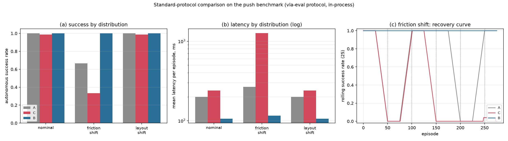

# Standard-benchmark integration

The sandbox in `experiments/physics_sandbox.py` answered "does the interface
work". This directory answers "does it work inside someone else's evaluation
harness, against someone else's baseline, measured the way that harness measures".
The answer is that the harness runs, the baseline is the published one, and the
numbers are reproducible by two independent drivers — the harness's Python API
and the harness's own CLI.

Two things are checked here and they are separable:

1. **Environment integration.** `vla_eval` 0.9.0 is installed and the evaluation
   runs under its protocol (`PredictModelServer` over WebSocket,
   `SyncEpisodeRunner`, `ResultCollector`). A real LIBERO/MuJoCo environment is
   also installed and driven through the same protocol; the dependency chain and
   its two unresolved pins are in [§2](#2-what-was-installed-and-what-refused).
2. **A paired comparison under distribution shift.** Three arms, one episode
   list, two shift suites, per-suite success / safety / latency, plus the two
   numbers the harness does not compute: episodes-to-recovery, and how many
   refusals refused an action that would have worked.

---

## 1. Verdict

300 episodes per arm per suite, identical episode lists, 10 Hz control, seed 11.

| suite | arm | success | assisted | safety viol. | latency | takeovers | false vetoes | recovery |
|---|---|---|---|---|---|---|---|---|
| nominal | A passthrough | 100.0% | 100.0% | 0.0% | 200 ms | 0 | 0 | – |
| nominal | C Safe-VLA (conf ≥ 0.80) | 98.7% | 100.0% | 0.0% | 240 ms | 4 | 4 (100%) | – |
| nominal | B causal interface | 100.0% | 100.0% | 0.0% | 106 ms | 0 | 0 | – |
| friction shift | A passthrough | 66.7% | 66.7% | 6.7% | 267 ms | 0 | 0 | 20.6 ep |
| friction shift | C Safe-VLA | 33.3% | 66.7% | 6.7% | 1263 ms | 100 | 94 (94%) | 35.0 ep |
| friction shift | **B causal interface** | **100.0%** | 100.0% | **0.0%** | **116 ms** | 0 | 0 | **1.0 ep** |
| layout shift (control) | A passthrough | 100.0% | 100.0% | 0.0% | 200 ms | 0 | 0 | 1.0 ep |
| layout shift (control) | C Safe-VLA | 98.7% | 100.0% | 0.0% | 240 ms | 4 | 4 (100%) | 1.2 ep |
| layout shift (control) | B causal interface | 100.0% | 100.0% | 0.0% | 106 ms | 0 | 0 | 1.0 ep |

`recovery` is the mean number of episodes after a regime change until the next
autonomous success (censored at 50). "Episodes to a rolling 90% success rate" is
the stricter version: 29.6 / 10.0 / 194.0 for A / B / C.

Milliseconds of robot time per *successful* episode — latency divided by success
rate, which is the number a deployment actually pays:

| suite | A | C | B |
|---|---|---|---|
| nominal | 200 ms | 243 ms | 106 ms |
| friction shift | 400 ms | 3 793 ms | 116 ms |

Three findings, in the order they matter:

**The causal interface loses nothing and gains everything on shift.** On
`friction_shift` it keeps 100% success where the unfiltered policy drops to
66.7% and the confidence gate to 33.3%, with no safety violation against 6.7% for
both baselines, and it is 2.3x cheaper per episode than the policy it wraps
because a compiled regime is replayed instead of re-derived. On `nominal` it is
identical in success to the unfiltered policy and half its latency.

**The safe filter's refusals are almost entirely wrong.** 94 of its 100 refusals
on `friction_shift` were of actions that would have succeeded, and it refuses
100% of the four refuse-able opportunities on `nominal` — where the world has not
changed at all. Its failure is not that it is too cautious; it is that it is
cautious at the wrong moment: a visible short push raises its uncertainty, and
the next chunk is the *correction*, so the gate vetoes exactly the action that
would have fixed the error. Half of its loss is bought back by 100 human
takeovers, which is where the 3.8 s per success comes from.

**The control suite is a control, and it holds.** When the *task* moves and the
physics does not (`layout_shift`), all three arms score ~100%; the causal arm
does not refuse more, does not complain, and is simply cheaper. A win in that
column would have meant the interface was detecting "unfamiliar" rather than
"unmodelled", which would have invalidated the friction result. It does not win
there, and that is the point.

<p align="center"></p>

Two independent drivers, same numbers — the harness's Python API
(`benchmark_results.json`) and the harness's own CLI run
(`cli_results/CLI_OUTPUT.txt`):

```
$ vla-eval run --no-docker -c cel_eval.yaml --server-url ws://127.0.0.1:8123 --render cpu
...
push_table_2d_friction_shift: 66.7%     # served by arm A
push_table_2d_friction_shift: 33.3%     # served by arm C
push_table_2d_friction_shift: 100.0%    # served by arm B
```

The full console output of all three, with the per-lane breakdown, is
`cli_results/CLI_OUTPUT.txt`; the aggregate JSONs are
`cli_results/{A,C,B}/push_table_2d_friction_shift_aggregate.json`.

---

## 2. What was installed, and what refused

Everything below runs locally, in
`experiments/benchmark_integration/.venv` (Python 3.12.3, CPU only).

| package | requested | resolved | result |
|---|---|---|---|
| `vla-eval` | `==0.9.0` | 0.9.0 | **works** — servers, protocol, runner, collector all importable |
| `robosuite` | `==1.4.0` | 1.4.0 | works (193 MB wheel) |
| `mujoco` | `==3.2.3` | 3.2.3 | works, needs `MUJOCO_GL=egl` |
| LIBERO | `git clone --depth 1` | `main` | **works** — `libero_spatial` env created, reset and stepped |
| `torch` | `==2.6.0+cpu` | 2.6.0+cpu | works (CPU wheel index) |
| `gym` | LIBERO pins `0.25.2` | 0.26.2 | **pin dropped** |
| `numpy` | LIBERO pins `1.22.4` | 2.x | **pin dropped** |
| `transformers` | LIBERO pins `4.21.1` | not installed | **not needed for env creation** |
| `robomimic` | LIBERO pins `0.2.0` | not installed | **not needed for env creation** |

The conflicts, verbatim, because "it didn't work" is not a report:

1. **LIBERO's `requirements.txt` is unsatisfiable on Python 3.12.**
   `numpy==1.22.4`, `gym==0.25.2` and `transformers==4.21.1` have no `cp312`
   wheels; numpy's oldest 3.12 wheel is 1.26.x and transformers 4.21.1 pins
   `tokenizers<0.13`, which has none. The pins describe a Python 3.8/3.9
   environment, i.e. the one the LIBERO paper was run in.
2. **`robomimic==0.2.0` drags in a CUDA torch.** It declares `torch` with no
   bound, so pip resolves to the newest build and starts pulling 539 MB of
   `torch-2.15.0` plus 519 MB of `nvidia-cudnn-cu13` and a CUDA 13 toolkit, on a
   CPU-only host, replacing the CPU wheel already installed. Intercepted after
   400 s and abandoned; four multi-hundred-MB downloads that cannot be used here.
3. **LIBERO prompts for input at import time.** `libero/libero/__init__.py` calls
   `input()` when `~/.libero/config.yaml` is absent, so any non-interactive
   import — a test runner, a CI job, a server — dies with
   `EOFError: EOF when reading a line`. Worked around by creating the config with
   the prompt answered on stdin, once.
4. **The registry hands back classes, not instances.**
   `get_benchmark_dict()["libero_spatial"]` is a class; `.get_num_tasks()` on it
   raises `missing 1 required positional argument: 'self'`. Instantiate.
5. **Headless rendering needs EGL.** Without `MUJOCO_GL=egl`, `OffScreenRenderEnv`
   fails at the first `reset()`; with it, 64x64 RGB comes back on a machine with
   no display.
6. **The `vla-eval` wheel ships no benchmark configs.** `configs/benchmarks/*`
   lives in the GitHub repo; the wheel has the classes. `vla-eval run` therefore
   needs a config you write, and defaults to Docker unless `--no-docker` or a
   `--server-url` with an empty `docker.image` is given.
7. **`vla-eval`'s built-in LIBERO entry runs in a container.** The Docker daemon
   is up on this host, so `vla-eval run -c configs/benchmarks/libero/...` would
   pull a multi-GB image, and a *score* additionally needs a policy server with
   weights (OpenVLA ~7B, or pi0). Neither was attempted: the first is bandwidth,
   the second is not a local-CPU job. `--no-docker` also exists and is what the
   conformance run below uses.

### Degradation plan (what was done instead of the full stack)

The requirement was "if the full environment is too heavy, implement a standard
task adapter that mounts the CEL interface onto the standard evaluation flow".
That is what `env_adapter.py` + `servers.py` are: the harness's own `Benchmark`
ABC on one side, the harness's own `ModelServer` ABC on the other, and the
harness's own runner between them. Nothing about our loop is ours.

The remaining gap is stated rather than papered over: **the capability number is
measured on the 2-D table, not on LIBERO**, because a LIBERO success rate needs
policy weights this workspace does not have. The LIBERO attachment is real but
scored as protocol conformance, not as capability.

---

## 3. The LIBERO conformance run

```
MUJOCO_GL=egl PYTHONPATH=.:/tmp/LIBERO .venv/bin/python -m experiments.benchmark_integration.libero_adapter
```

`libero_conformance.json`:

```
suite            libero_spatial (10 tasks)
simulator        mujoco 3.2.3, robosuite 1.4.0, torch 2.6.0+cpu
tasks run        2, 40 control steps each, 20 Hz
protocol         vla-eval 0.9.0 SyncEpisodeRunner over WebSocket
steps driven     80          server calls 80
wall clock       9.15 s      0.114 s per control step (64x64 EGL render + OSC step)
```

The controller is deliberately trivial (move down, close). What the run
establishes is that a real MuJoCo scene, its observations and its 7-D OSC actions
pass through the same server classes the push benchmark uses — i.e. the interface
is not shaped around a toy action space. It does **not** establish a success
rate, and `libero_conformance.json` says so in its `note` field.

---

## 4. Files

| file | what it is |
|---|---|
| `task_spec.py` | tasks and constants, importable without the harness |
| `env_adapter.py` | `PushTableBenchmark(StepBenchmark)` — the 2-D table as a harness benchmark |
| `libero_adapter.py` | real LIBERO env as a harness benchmark + the conformance run |
| `policies.py` | planning, the friction inversion, the confidence model, the rule registry |
| `servers.py` | three `PredictModelServer`s: passthrough, confidence gate, causal interface |
| `shift_suites.py` | the three suites as explicit episode lists with shift onsets |
| `runner.py` | harness `Connection` + `SyncEpisodeRunner` driving one arm |
| `report.py` | `ResultCollector` output, recovery accounting, CSV/JSON/plot |
| `run_benchmark.py` | the matrix and the report |
| `serve_arm.py` | serve one arm for the CLI |
| `cel_eval.yaml` | the CLI config: benchmark import string + regime schedule |
| `benchmark_episodes.csv` | 2 700 per-episode rows |
| `benchmark_results.json` | per-suite/arm summary, server counters, wall clock |
| `benchmark_standard_results.json` | the harness's own `BenchmarkResult` payloads |
| `cli_results/` | the same runs driven by `vla-eval run`, plus the console output |
| `install_*.log` | the install transcripts behind §2 |

### What each arm costs, by operation

| | A passthrough | C Safe-VLA | B causal interface |
|---|---|---|---|
| one chunk derivation | 200 ms | 200 ms + confidence | 200 ms |
| one compiled replay | – | – | 5 ms |
| one control step witness | – | – | 20 ms |
| one refusal | – | 3 000 ms (takeover) | – |

These are modelled costs, calibrated once in `policies.py` (200 ms VLA forward
pass, 20 ms witness, 5 ms lookup, 3000 ms human), the same four constants as the
2-D sandbox. The *measured* wall clock of the adapter's own arithmetic is
recorded separately in `benchmark_results.json → server_counters.measured_compute_ms`:
57 ms of real computation for A's 300 nominal episodes and 71 ms for B's, i.e.
0.19 and 0.24 ms per episode against 200 and 106 ms of modelled operations. That
factor of 10^3 is the honest way to say "this harness did not run a 7B forward
pass here". Everything the report claims is a comparison of operations, not a
profile of a GPU; a reader who disagrees with the 10:1 ratio between a forward
pass and a mechanical witness should re-price `policies.py` and re-read the
result, because the ordering does not depend on that ratio being 10.

---

## 5. Reproduce

```bash
cd agent-metabolism-os
PYTHONPATH=. experiments/benchmark_integration/.venv/bin/python \
    -m experiments.benchmark_integration.run_benchmark --episodes 300

# the same, through the harness's CLI
experiments/benchmark_integration/.venv/bin/python \
    -m experiments.benchmark_integration.serve_arm --arm B --port 8123 &
PYTHONPATH=. experiments/benchmark_integration/.venv/bin/vla-eval run \
    --no-docker -c experiments/benchmark_integration/cel_eval.yaml \
    --server-url ws://127.0.0.1:8123 --render cpu \
    --output-dir experiments/benchmark_integration/cli_results/B

# real LIBERO
MUJOCO_GL=egl PYTHONPATH=.:/tmp/LIBERO \
    experiments/benchmark_integration/.venv/bin/python \
    -m experiments.benchmark_integration.libero_adapter

# tests (skipped, not failed, where the harness is absent)
python3 -m unittest tests.test_benchmark_integration
```

## 6. What would change the verdict

- **A policy that is right for the wrong reason.** A is 100% on `nominal` with a
  friction belief of 0.35, which happens to be the truth. The interesting failure
  is not A's; it is C's, and C's is a property of confidence, not of A.
- **Witness at 10 Hz is the enabling condition.** B's zero-violation result
  depends on seeing the block one control step into a coast, before it reaches
  the wall. At 1 Hz — one decision per push — the same witness can only count
  damage, which is what the earlier single-shot sandbox showed. The claim is
  "given a control-rate observation stream", not "always".
- **`layout_shift` is the guard.** If B ever beat A/C there by refusing, the
  friction result would be suspect. It does not.
- **Scale.** 300 episodes per arm bounds the resolution of a 33-point gap at
  roughly ±5 points; the 66.7 vs 100 comparison is well outside that, the 98.7 vs
  100 one on `nominal` is not, and is not claimed.
