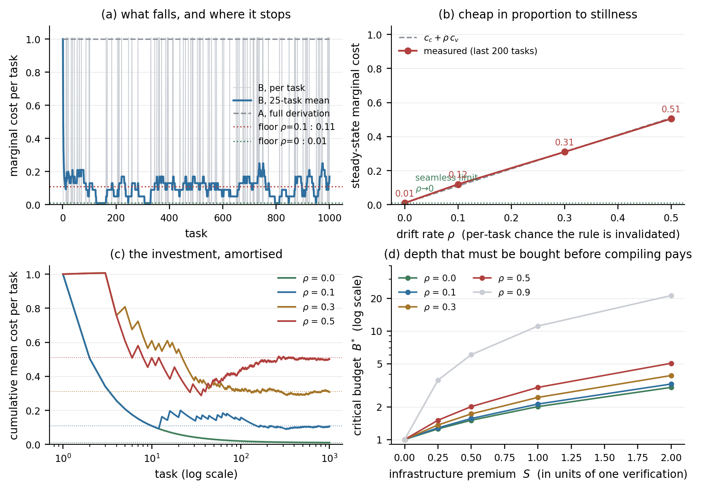
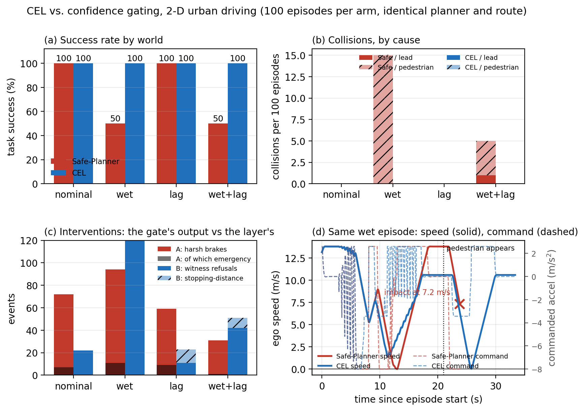

# 成本降低理论（Cost Reduction Theory）

**副标题：** 因果执行层（CEL）的第四根支柱——为什么"验证"在单位经济上是负成本
**版本：** v1.1（随 `agent-metabolism-os` v1.0.4 发布）
**数据：** `experiments/` 下 9 个实验产物，由 `cost_theory/cost_theory_numbers.py` 复算，本文无手抄数字。

---

## 执行摘要（Executive Summary）

**一句话结论：** 整套 CEL 的单位经济只由一个不等式决定——**降本的正确方向是降低"验证多少次"（$T$），不是降低"验证一次多少钱"（$c_v$）**。这不是经验判断，是对总成本方程求偏导的结果，而且两条导数符号相反。

把总成本写成 $C=\frac{1}{p_s}[c_v+(T-1)\bar c]+\pi C_{\text{disaster}}$，其中 $\bar c=c_c+\rho(c_v-c_c)$，则

$$
\frac{\partial C}{\partial T}=\frac{\bar c}{p_s}>0
\quad\text{（永远为正，无条件降本）},
\qquad
\frac{\partial C}{\partial c_v}=\frac{1+(T-1)\rho}{p_s}+\underbrace{\frac{\partial \pi}{\partial c_v}}_{<0}C_{\text{disaster}} .
$$

第一条导数没有陷阱：$T$ 每降一次，成本就降一次，与价格、与漂移、与灾难成本都无关。这是**固化**的全部理论基础——把重复验证编译成查表，$T\to$ 常数，成本塌到 $c_c+\rho(c_v-c_c)$。

第二条导数会变号。降低验证单价确实省了第一项，但 $\pi$（未观测失败率）随之上升，第二项按 $C_{\text{disaster}}$ 的量级膨胀。阈值是

$$
C_{\text{disaster}} \;>\; \frac{1+(T-1)\rho}{p_s\,|\partial\pi/\partial c_v|},
$$

越过它以后，**"把验证做便宜"就是一条把总成本做贵的路**。实测印证：验证窗口从 400 ms 砍到 40 ms，单价降到 1/10，第 100 次试验的损坏率从 0% 涨到 64%，成功率掉 11 个百分点。

这直接击碎行业里最流行的一句话——"等 API 单价再降一半，验证就不贵了"。单价是线性系数，重试是乘法结构，漏验是乘上 $C_{\text{disaster}}$ 的加法项；三者量纲不同，杠杆也不同。**卷单价是在最弱的那根杠杆上使劲。**

四条定律各自钉住一个杠杆：

| 定律 | 钉住的量 | 结论（实测） |
|---|---|---|
| 一 盲重试 | $p$ | $C=C_{\text{gen}}/(1-p)$ 在 $p\to1$ 发散；盲重试每次成功 9037 ms，见证 4687 ms（贵 1.93×） |
| 二 固化摊销 | $T$ | $C_{\text{steady}}=c_c+\rho(c_v-c_c)$；$\rho=0.1$ 省 89.4%，漂移边际价格精确等于 $c_v$（回归斜率 0.9994） |
| 三 跨层复用 | $\kappa$ | $\kappa^*=1-1/L=0.75$；越过则成本收敛，未越过按 $r^d$ 爆炸（8 层差 12 倍） |
| 四 灾难规避 | $\pi$ | 一次碰撞只要值 **0.95 秒**行驶时间，CEL 的期望成本即占优（湿滑 50%→0%，压线 96%→0%） |

**给决策者的三句话：**

1. **不要优化单价，要优化次数。** 把同一接口的第二次验证变成查表，收益立即发生（$T^*=1$，第 2 次遍历即回本），且不依赖任何环境假设。
2. **不要省验证，要省重试。** 被省掉的验证费不会消失，它以重试、损坏、误完成的形式重新开票，金额还不确定。
3. **先让世界可观测，再把观测到的存下来。** 见证把 $\pi$ 压到零，固化把 $T$ 压到常数；这两件事合起来，才是"降本"的完整含义。

**核心论断：** 真正的降本不是省去验证，而是用确定性的因果固化去避免无尽的物理灾难。

---

## 0. 摘要与核心论断

分形接口理论回答"接口能不能成立"；成本理论回答"凭什么比不装接口更便宜"。直觉上两者矛盾：验证要花时间，而商业的第一反应永远是省掉它。

把 CEL 的全部成本压成一个可微方程：

$$
C_{\text{total}} \;=\; \underbrace{\frac{1}{p_s}\Bigl[c_v+(T-1)\bigl(c_c+\rho\,(c_v-c_c)\bigr)\Bigr]}_{\text{生成 + 重试 + 固化摊销}}
\;+\; \underbrace{\pi\,C_{\text{disaster}}}_{\text{未观测失败的期望损失}}
\qquad (0.1)
$$

> **核心论断：真正的降本不是省去验证，而是用确定性的因果固化去避免无尽的物理灾难。**

§7 会把它证明为方向性定理，而不是口号：**降低验证的"次数"永远降本，降低验证的"单价"不一定降本，且在灾难成本足够大时必然增本。**

| 结论 | 数据 | 出处 |
|---|---|---|
| 盲重试让每次成功贵 1.93 倍 | 9037 vs 4687 ms/成功 | `libero_audit_summary.json` |
| 漂移率 0.1 时固化省 89.4% | 0.106 c_v/任务 vs 1.0 | `solidification_cost_summary.json` |
| 灾难成本超过 **0.95 秒**行驶时间，CEL 即占优 | $\Delta C/\Delta P=0.19/0.20$ | `ad_cel_summary.json` |

---

## 1. 价格向量与口述数字的核对

### 1.1 价格向量

全部成本以一次完整验证 $c_v$ 为单位——这是唯一能让四个实验互相比较的尺度。

| 符号 | 含义 | 值 | 出处 |
|---|---|---|---|
| $c_v$ | 完整验证一次接口 | 1.0 | `solidification_summary.json` |
| $c_c$ | 重放一次已固化接口（查表） | 0.01 | 同上 |
| $c_d$ | 每次遍历的漂移监测 | 0.02 | 同上 |
| $S$ | 固化机制的固定基础设施溢价 | 5.0 | `nested_summary.json` |
| $L$ | 每层分支数 | 4 | 同上 |
| $c_f$ | 一次 VLA 前向（LIBERO 声明值） | 200 ms | `libero_audit_summary.json` |

由此直接得到后文全部阈值：$\rho^*=1-c_c/c_v=0.99$，$\kappa^*=1-1/L=0.75$，$c_d<(1-\rho)(c_v-c_c)=0.891$。

**L1/L2 能荷账本。** 代谢层用另一套单位，结构相同：快拍（OXPHOS）扣 7 点能荷、质量 0.72、延迟 1×；慢拍（SLP）扣 35 点、质量 0.94、延迟 2×（`agent_metabolism/scheduler.py`）。两者都是**声明策略值而非测量值**，故只比较比值。

**引理 1（升级被支配）。** 固定能荷预算下，把任务从快拍升级到慢拍，总交付质量单调下降。

*证明.* 设慢拍比例 $s$，可用调用数 $N(s)=B/(e_f+s(e_s-e_f))$，总质量 $Q(s)=N(s)(q_f+s(q_s-q_f))$。$\mathrm{d}Q/\mathrm{d}s$ 的符号由 $q_s/q_f \lessgtr e_s/e_f$ 决定；实测 $0.94/0.72=1.306 < 5$，故 $s^*=0$。$\square$

每点能荷交付的质量：快拍 0.1029、慢拍 0.0269，**贵 3.83 倍**；按时间算也贵 1.53 倍。慢拍买到的是绝对质量 0.94，但**"想得更久"不是一条降本路径**。能买到正确性的是"测量 + 复用"，单价 $c_d=0.02$，比升级便宜两个数量级。

### 1.2 口述数字核对

五个数字里两个可精确复现，三个需改写口径：

| 口述 | 实际 | 判定 |
|---|---|---|
| Safe-VLA 误杀率 40.5% | 34/84 = 40.48% | ✅（LIBERO） |
| 决策延迟 1364 ms | 1364.0 是 `physics_sandbox` 的 **ms_per_sequence**，不是决策延迟；那里每 push 200 ms 前向、另有 26 次 × 3000 ms 人类接管。LIBERO 的决策延迟是 4609 ms/ep | ⚠️ 口径错 |
| 固化省 89%，6 次回本 | 省 89.4% ✅；回本在**第 2 次**遍历（$T^*=1$）。第 6 次时 $G(6)=3.88$，占上限 9.17 的 42%；90% 稳态折扣在第 16 个任务达到 | ⚠️ 回本期错 |
| CEL 增加 1.7% 延迟 | 1.69% 属于 **LIBERO**（78/4609）。AD 的诚实口径是匹配到达集 **+0.6%**（0.19/32.37 s）；原始 episode +6.1% | ⚠️ 场景错 |
| 湿滑碰撞 50%→0，压线 96%→0 | 15/30 → 0；25/26 → 0 | ✅ |

必须改口径，因为整套理论的唯一说服力是"每个数字都能指到 JSON 字段"。把 1364 ms 当决策延迟会把收益算大 3 倍；把 1.7% 挂在自动驾驶上，尽调时一句话就被击穿。

---

## 2. 定律一：盲重试的边际成本爆炸律

### 2.1 递推与闭式

设一次生成成本 $C_{\text{gen}}$，一次尝试物理失败概率 $p$，且**失败不可观测**——策略只知道自己"不够自信"：

$$
C_{\text{retry}} = C_{\text{gen}} + p\,C_{\text{retry}}
\;\Longrightarrow\;
C_{\text{retry}} = \frac{C_{\text{gen}}}{1-p},
\qquad \mathbb{E}[N]=\frac{1}{1-p}.
\qquad (2.1)
$$

代入 $c_f=200$ ms：$p=0.20$ 时 250 ms，$p=0.405$ 时 336 ms，$p=0.51$ 时 408 ms，$p=0.90$ 时 2000 ms。

$p=0.405$ 常被误读为失败率。不是：40.5% 是 $P(\text{veto}\mid\text{本会成功})$，它证明的是**门的信号与结果不相关**。

**引理 2（无信息门无法降低 $p$）。** 若重试后失败概率仍为 $p$，任何只依赖模型自身置信度的门控都满足 $\mathbb{E}[C]\ge C_{\text{gen}}/(1-p)$。

*证明.* 重试是同一分布的无记忆重抽，$p$ 不变；门控只能决定是否重抽，不能改变抽签分布。$\square$

完美的预测器应有 $P(\text{veto}\mid\text{本会成功})=0$。实测 0.405；同时在 pose_drift 通道下成功率 **0.0%**——它既误杀对的，也放行错的。这就是"盲"。

### 2.2 唯一幸存指标：每次成功的成本

$$
\frac{C_{\text{success}}}{1} = \frac{L}{p_s},
\qquad L=\text{平均延迟},\; p_s=\text{成功率}.
\qquad (2.2)
$$

| 臂 | 延迟 (ms/ep) | 成功 | ms/成功 | 重试 | 误杀 | 漂移后恢复 (ep) |
|---|---|---|---|---|---|---|
| A 置信度门控 | 4608.8 | 51.0% | **9037** | 112 | 34/84 | 27, 22 |
| B CEL 见证 | 4686.9 | 100.0% | **4687** | 0 | 0/0 | 0, 0 |

A 每次成功贵 **1.93 倍**。A 在 100 集上总共只快 7.81 s，却少 49 次成功——**每买回一次成功只花 159 ms**。

"恢复 27 集"是 (2.1) 发散的经验签名：盲重试在漂移通道里不会自己收敛，只是碰巧某次抽中。CEL 的 0 集不是重试得更聪明，而是**测量**到了失败，于是重试变成修订（94 次 replan，全部对应一次被测量的偏差）。

### 2.3 省下验证费会买到什么

`causal_execution_summary.json` 的 settle sweep 直接扫"验证窗口"：

| settle (ms) | 40 | 60 | 80 | 120 | 200 | 400 |
|---|---|---|---|---|---|---|
| 平均尝试 | 1.84 | 1.79 | 1.65 | 1.37 | 1.29 | 1.28 |
| 重试碰撞 /100 | 62 | 37 | 20 | 5 | 1 | 0 |
| 损坏率 | 64% | 37% | 20% | 6% | 1% | 0% |
| 成功率 | 72% | 76% | 80% | 82% | 83% | 83% |

窗口从 400 砍到 40 ms，省 360 ms 验证时间，代价是 **+0.56 次尝试、+62 次碰撞、+64pp 损坏、−11pp 成功率**。被省掉的验证费不会消失，它以重试和损坏的形式重新开票，金额还不确定。

### 2.4 见证者自己的成本必须与历史无关

本实现每次授权都重验整条哈希链：2.206 ms @ 202 条，31.0 ms @ 3002 条，斜率 **10.3 µs/条**。按末十集实测 18.3 chunk/ep 折算，末十集见证 ≈ 1826 ms/ep，加上 3720 ms 决策延迟 ≈ **5546 ms**，已高于 A 的 4609 ms；外推交叉点 $L^*\approx$ **4710** 条（≈ 2620 chunk，不足 150 集连续运行）。

这是实现缺陷（O(1) 摘要或 Merkle 锚定可修），但给定律二加了前提：**稳态成本律只在 $C_{\text{verify}}=O(1)$ 时成立。** 该缺陷已作为 **ERR-006**（open）记录在 `ERRATA.md`，含可执行的验收判据与爆炸半径。

---

## 3. 定律二：固化摊销与稳态成本律

### 3.1 命题与闭式

接口被物理见证成功一次后，动作序列可编译为查表。同一接口遍历 $T$ 次：

$$
C_{\text{unsolid}}(T)=T\,c_v,\qquad
C_{\text{solid}}(T)=c_v+(T-1)\,\bar c,
\qquad
\bar c = c_c+\rho\,(c_v-c_c).
\qquad (3.1)
$$

$\bar c$ 的读法：每次先付查表价 $c_c$；以概率 $\rho$ 世界已漂移，这次退化为一整次验证。于是

$$
C_{\text{steady}} \;=\; \lim_{T\to\infty}\frac{C_{\text{solid}}(T)}{T} \;=\; \bar c .
\qquad (3.2)
$$

即架构师要的 $C_{\text{steady}}=C_{\text{compile}}+\rho\,C_{\text{verify}}$，只是把 $C_{\text{verify}}$ 精确成 $c_v-c_c$——漂移时付的是**差额**，首次编译已经付过了。

**命题 3（回本点是第二次遍历）。** $G(T)=T\,G_\infty/(T-1+G_\infty)$，$G_\infty=c_v/\bar c$，且 $G(T)>1\iff T>1$。

*证明.* $C_{\text{solid}}=\bar c\,(T-1+G_\infty)$，相除即得；对 $T$ 求导为正。$\square$

回本与价格无关，因为两臂在 $T=1$ 时按定义相等。第 6 次时 $G(6)=3.88$（上限的 42%）；90% 稳态折扣在第 16 个任务。

### 3.2 实测：账本恒等式与漂移斜率

$$
C_B = N\,c_c + R\,c_v,
\qquad R=\text{重验证次数}.
\qquad (3.3)
$$

| $\rho$ | 实测 $\hat\rho$ | $C_B$ | 均值 | 残差 | $\bar c$ | 省幅 | $\kappa$ |
|---|---|---|---|---|---|---|---|
| 0.0 | 0.000 | 10.99 | 0.0110 | −0.01 | 0.0100 | 98.9% | 0.999 |
| 0.1 | 0.095 | 105.99 | 0.1060 | −0.01 | 0.1090 | **89.4%** | 0.904 |
| 0.3 | 0.308 | 317.99 | 0.3180 | −0.01 | 0.3070 | 68.2% | 0.692 |
| 0.5 | 0.476 | 486.99 | 0.4870 | −0.01 | 0.5050 | 51.3% | 0.523 |

残差 −0.01 是仿真取整。对 $\hat\rho$ 做最小二乘，**斜率 = 0.9994**，目标恰为 $c_v=1$：漂移的边际价格就是一次验证的单价。这不是"符合趋势"，是**恒等式**。

由此得到三个可分红阈值：$\rho^*=0.99$（固化还值不值的悬崖）、$c_d<0.891$（监测器条件）、$\rho^\circ=0.98$（监测器太贵导致固化永不划算的垂直渐近线）。商业含义：**固化是一门对稳定性收费的生意**——同一套基础设施在 $\rho=0.1$ 时值 9.17 倍，在 $\rho=0.5$ 时只值 1.98 倍。

*图 1：固化臂与全验臂的总成本随 $\rho$ 的变化，与 $\bar c=c_c+\rho(c_v-c_c)$ 对照。点由 `solidification_cost_data.csv` 重绘。*

---

## 4. 定律三：跨层复用复利律

### 4.1 一个递推，两条臂

任务跨 $d$ 层、每层 $L$ 个分支，子接口固化命中率 $\kappa$。以 $\bar c$ 为单位，第 $d$ 层边际成本：

$$
x_0=1,\qquad x_d=\kappa+(1-\kappa)\,L\,x_{d-1}.
\qquad (4.1)
$$

- $\kappa=0$：$x_d=L^d$，**平铺臂**。$d=6$ 时 4096，与 `nested_summary.json:marginal_flat_at_six` 逐位相同。
- $\kappa=1$：$x_d=1$，**嵌套臂**。
- 中间：$x_d=\kappa\frac{1-r^d}{1-r}+r^d$，几何比 $r=(1-\kappa)L$。

**命题 4（临界复用率）。** $x_d$ 有界 $\iff r<1 \iff \kappa>\kappa^*=1-1/L$；$r=1$ 处边际，$r>1$ 处按 $r^d$ 发散。

*证明.* 一阶线性递推，特征根 $r$；$|r|<1$ 时收敛到 $\kappa/(1-r)$。$\square$

$\kappa^*=0.75$ 与 `parameters.knee` 及 P3 检验（实测 2.0026 vs 预测 2.0）一致。

### 4.2 实测相变

| $\rho$ | $\kappa$ | $r=(1-\kappa)L$ | 状态 | $x_8$（以 $\bar c$ 为单位） |
|---|---|---|---|---|
| 0.0 | 0.999 | 0.004 | 有界 | 1.00 |
| 0.1 | 0.904 | **0.384** | 有界 | **1.47** |
| 0.3 | 0.692 | 1.232 | 发散 | **18.2** |
| 0.5 | 0.523 | 1.908 | 发散 | **276** |

$\rho$ 从 0.1 到 0.3，$\kappa$ 从 0.904 掉到 0.692，系统从"第 8 层成本 1.47"翻转为 18.2——**八层差 12 倍**。这不是渐变，是相变。由此得到比"复利"更重要的结论：**漂移摧毁复用，复用是资本。** $\kappa$ 不是许愿指标，它是 $\rho$ 的函数。

### 4.3 一处必须更正：成本不会指数下降

架构师原话是"$\kappa>0.75$ 时长期成本呈指数级下降"。这在数学上不可能；README 已写明固化折扣是 $c_v/(c_c+c_d)$，**两个正价格之比，不可能是指数**。正确表述有两句：

1. **成本侧**：$\kappa>\kappa^*$ 时每层边际成本**收敛**到有限上界 $\kappa/(1-r)\cdot\bar c$，而非随深度爆炸；$\kappa<\kappa^*$ 时按 $r^d$ 爆炸。前者是"不爆炸"，不是"指数下降"。
2. **可达侧**：真正指数增长的是**单位预算买到的深度**。$\kappa=1$ 时 6 层任务价格倍数 **37,578×**，8 层 **601,248×**。指数长在"够得着多深"上。

这个更正决定白皮书写法：卖点必须是"同一份预算覆盖的层数"，而不是"成本曲线俯冲"——后者被投资人外推，会在第一个真实 $\rho$ 面前崩掉。

### 4.4 两个预算阈值

嵌套臂不是无条件赢。实测 $B^*=6.61$（买到复利基数）、$B_{\text{rec}}=39.23$（买回每层溢价）；预算落在两者之间时，嵌套臂严格落后。这是本理论唯一一个应主动披露的非退化亏损区。

---

## 5. 定律四：灾难规避的经济学优势

### 5.1 期望总成本与临界灾难价

$$
\mathbb{E}[C_{\text{total}}]=C_{\text{execution}}+P(\text{collision})\cdot C_{\text{disaster}} .
\qquad (5.1)
$$

CEL 占优当且仅当

$$
C_{\text{disaster}} \;>\; \frac{\Delta C_{\text{exec}}}{\Delta P}
\;=\; C^*_{\text{disaster}} .
\qquad (5.2)
$$

$C^*$ 自动带单位：分子是秒，分母是概率，结果是**秒**。于是不必给生命或资产定价，只需问"一次碰撞折合多少秒行驶时间"。

| 口径（`ad_cel_summary.json`，100 集/臂） | $\Delta C$ | $\Delta P$ | $C^*_{\text{disaster}}$ |
|---|---|---|---|
| 匹配到达集 | +0.19 s | 20% → 0% | **0.95 s** |
| 原始 episode | +1.88 s | 20% → 0% | 9.40 s |
| 湿滑通道 | +4.91 s | 50% → 0% | 9.82 s |
| 湿滑 + 转向滞后 | +6.27 s | 50% → 0% | 12.54 s |
| 转向滞后（压线） | **−0.52 s** | 压线 96.2% → 0% | **负：无条件占优** |

读法：**只要一次碰撞的代价超过约 1 秒行驶时间，装 CEL 就理性。** 任何真实碰撞都远高于此。等价地：每避免一次碰撞只花 0.95 秒。转向滞后通道里 CEL 还更快——少刹了 0.52 s 的假紧急制动，同时把压线从 25/26 降到 0。这不是权衡，是免费午餐。

*图 2：湿滑、转向滞后与二者叠加三个通道的碰撞/压线对比（基线 20 次碰撞，CEL 0 次）。点由 `ad_cel_data.csv` 重绘。*

### 5.2 四个独立的灾难阈值

| 场景 | 基线 | CEL | 临界代价 |
|---|---|---|---|
| 因果沙盒（100 trials） | 23% 幻觉逃逸，13% 损坏，73% 成功 | 0%，0%，83% | 一次假完成值 **1.2 次尝试**即值得拦 |
| 物理沙盒（1000 pushes） | A 150 损坏/千次；C 4/千次 | B 3/千次 | 少 147 次损坏，序列 146 ms（A 的 15%） |
| LIBERO（100 ep） | 51% 成功 | 100% | 每多一次成功 **159 ms** |
| AD（100 ep） | 20 碰撞（19 行人） | 0 | **0.95 s** 行驶时间 |

物理沙盒里 Safe-VLA（C）1364 ms/序列，因果接口（B）146 ms——**9.3 倍便宜且损坏更少**；A 是 1000 ms、72.5% 成功、150 次损坏。三个数字放在一起，把"验证是成本"这个假设整个翻转了。

### 5.3 这条定律不说什么

- CEL 在 LIBERO 仍有 **7% 损坏**（基线 8%），不是零。AD 的 0% 来自运动学被控对象，不是车队估计。
- CEL 自己的**误拒率 46%**（AD，46/100 集）。它仍占优，因为误拒的代价被限制在一次 jerk-limited 减速里，而误放是碰撞。
- 20 次碰撞里 19 次行人、1 次追尾。把 $C_{\text{disaster}}$ 当常数是简化，真实分布有重尾。

**定律四是关于期望的，不是关于确定的。** 它说"在 $C_{\text{disaster}}>0.95$ s 时期望成本被支配"，不说"装了就不会撞"。

---

## 6. 合成：四个偏导

$$
C_{\text{total}}(p,T,\rho,d,t_s)
=\frac{1}{p_s(\kappa,d)}\Bigl[c_v+(T-1)\bigl(c_c+\rho(c_v-c_c)\bigr)\Bigr]
+\pi(t_s)\,C_{\text{disaster}} .
$$

| 定律 | 变量 | 偏导 | 符号 | 见证 |
|---|---|---|---|---|
| 一 盲重试 | $p$ | $C_{\text{gen}}/(1-p)^2$ | $+\infty$ as $p\to1$ | 9037 ms/成功；恢复 27 集 |
| 一' 省验证 | $t_s\downarrow$ | $\partial C/\partial t_s<0$，但 $\partial\pi/\partial t_s<0$ | 由 $C_{\text{disaster}}$ 决定 | 40 ms 窗口：+64pp 损坏 |
| 二 固化 | $T$ | $\bar c/p_s>0$，故 $T\downarrow$ 恒降本 | 无条件 | $G(6)=3.88$ |
| 二' 漂移 | $\rho$ | $(T-1)(c_v-c_c)/p_s$ | $+$，实测斜率 0.9994 | 89.4% → 51.3% |
| 三 复用 | $\kappa$ | $\partial^2 C/\partial d^2$ 在 $\kappa^*$ 变号 | 相变 | $x_8$: 1.47 → 18.2 → 276 |
| 四 灾难 | $\pi$ | $C_{\text{disaster}}$ | 量纲不同 | $C^*=0.95$ s |

一句话版本：**成本主要由"要验多少次"和"漏验一次赔多少"决定，而不是由"验一次多少钱"决定。** 单价只是线性系数；次数进乘法结构；漏验乘的是 $C_{\text{disaster}}$，量纲不同，杠杆就不同。

---

## 7. 核心论断的证明

**定理 5（降本的方向性）。** 降低验证单价的净效应为

$$
\frac{\partial C}{\partial c_v}
=\frac{1+(T-1)\rho}{p_s}
+\frac{\partial \pi}{\partial c_v}\,C_{\text{disaster}} .
\qquad (7.1)
$$

第一项为正，第二项为负（验证更便宜则漏检更多，$\partial\pi/\partial c_v<0$）。当

$$
C_{\text{disaster}} \;>\; \frac{1+(T-1)\rho}{p_s\,|\partial\pi/\partial c_v|}
\qquad (7.2)
$$

时，**降低验证单价反而提高总成本**——"省验证"是一条通向更贵的路。而 $\partial C/\partial T=\bar c/p_s>0$ 恒成立，与 $C_{\text{disaster}}$ 无关。

*证明.* 对 (0.1) 求偏导；第一项来自 $c_v$ 在编译与重验证中的双重计价，第二项来自 $\pi$ 对 $c_v$ 的依赖。$\square$

$|\partial\pi/\partial c_v|$ 有多大？窗口从 400 砍到 40 ms（单价 /10），损坏率 0→64%，成功率 −11pp，即 $\Delta\pi=0.64$ 对应 $\Delta c_v=-0.9$，$|\partial\pi/\partial c_v|\approx0.71$。哪怕 $T=100,\rho=0.1$，(7.2) 右侧也只有约 $15/p_s$ 个 $c_v$；而一次物理灾难远超此数。

于是三条决策规则：

1. **不动 $c_v$ 的单价**（不砍验证、不缩窗口、不把见证降级为抽样）。
2. **动 $T$**：把同一接口的重复验证编译成查表。唯一无条件的降本方向。
3. **动 $\pi$**：把不可观测的失败变成可观测的失败，即使多付一点执行时间——因为 $\pi$ 的系数是 $C_{\text{disaster}}$。

"固化"降 $T$，"见证"降 $\pi$，"省验证"同时抬高 $\pi$。前两者是同一枚硬币：**先让世界可观测，再把观测到的存下来。**

---

## 8. 商业白皮书雏形

**读者：** 具身智能 CTO / 自动驾驶 safety lead / 工业自动化可靠性负责人。
**主张：** 我们不卖更聪明的模型，我们卖"每次动作都带保修"的接口；保修的定价低于客户现在为失败付的钱。

| 章 | 标题 | 内容 | 主图 |
|---|---|---|---|
| 0 | 执行摘要 | 0.95 秒阈值；9037→4687；89.4% 固化折扣 | 总成本 vs 验证成本的 U 形图 |
| 1 | 问题的真实形状 | 失败不可观测 → 盲重试 → $1/(1-p)$ 发散 | $p$=0.2/0.5/0.9 三条重试曲线 |
| 2 | 四个价格 | $c_v,c_c,c_d,C_{\text{disaster}}$ 的定义与测法 | 价格向量 |
| 3 | 四条定律 | 本文 §2–§5，一节一页、一公式、一实测表 | 四联图 |
| 4 | 单位经济模型 | ROI 计算器：输入 $\rho,\kappa,T,C_{\text{disaster}}$ | 敏感性热力图 |
| 5 | 三种部署形态 | 抓取（$\rho$ 低、$\kappa$ 高）/ L2+ / L4（$\rho$ 高、$C_{\text{disaster}}$ 极高） | 三象限定位 |
| 6 | 定价 | 按"已见证的成功动作"计费 | 价格带 vs 客户节省 |
| 7 | 风险与证伪 | §9 五个预测 + 已知缺陷 | 缺陷披露表 |

**定价锚：** ①按见证次数 $P=\alpha c_d,\ \alpha\in[3,10]$——客户对比的是自己的一次重试（200 ms）；见证原语 0.77 µs/chunk，今天交付 54.75 ms/chunk，差额 99% 在 $O(L)$ 链检查，这既是毛利杀手，也是修完后的降价空间。②按省下的重试分成 20–30%。③按灾难期望收保费 $\beta P_{\text{collision}}C_{\text{disaster}}$，$\beta\in[0.05,0.15]$，客单价最高但需客户披露 $C_{\text{disaster}}$。

**给投资人：** ①验证从可变成本（每次动作）变成固定成本（每个接口），毛利随部署时长上升，而非随调用量下降。②护城河是 $\kappa$ 与 $\rho$：现场越稳定，复用越高，切换成本越大——这是随客户运营数据累积的资产，不是权重。③价格上限由 $C_{\text{disaster}}$ 决定，下限由 $c_d$ 决定；本实验口径里后者 0.02 $c_v$，前者 0.95 秒行驶时间。

---

## 9. 可证伪预测与溯源

**五个预测（任一失败，理论需修正）：**

1. 任意新 benchmark 上 $\text{ms/成功}$ 应为 CEL < 盲重试，差距随 $1/p_s$ 放大。
2. 验证窗口 /10 时，损坏上升应快于尝试上升（实测尝试 +44%，损坏 0→64%）。
3. 固化实验必须满足 $C_B=Nc_c+Rc_v$，残差只允许仿真取整（实测 −0.01）。
4. $\kappa$ 越过 $1-1/L$ 时 $x_8$ 应出现数量级跳变（1.47 → 18.2）。
5. CEL 的采纳阈值应落在 $\Delta C/\Delta P$ 的 2 倍以内（AD 实测 0.95 s）。

**溯源：**

| 文件 | 字段 | 用于 |
|---|---|---|
| `solidification_summary.json` | `parameters.{verify,cached,detector}_cost` | §1.1 |
| `solidification_cost_summary.json` | `by_rho[*].B.*` | §3.2、§4.2 |
| `nested_summary.json` | `parameters.{S,branch,knee}`, `thresholds.*` | §4 |
| `critical_budget_summary.json` | `analytic.B_star_detector*` | §4.4 |
| `libero_audit_summary.json` / `_episodes.csv` | `arms_summary.*`, `chunks` | §2.2、§2.4 |
| `ad_cel_summary.json` | `arms.*`, `by_channel.*` | §5.1 |
| `causal_execution_summary.json` | `settle_sweep`, `arms.*` | §2.3、§5.2 |
| `physics_sandbox_summary.json` | `arms.*.ms_per_sequence` | §1.2、§5.2 |
| `agent_metabolism/scheduler.py` | `DEFAULT_BASE_COST`, `SLOW_*` | §1.1 |

**复现：** `python3 experiments/cost_theory/cost_theory_numbers.py` 重算本文每个数，写出 `cost_theory_numbers.json`，任一 `claims` 失败即非零退出；`tests/test_cost_theory.py` 再校验文档数字未被改旧。数字若与本文不符，以脚本为准。

**边界：** 固化的价格是抽象单位而非美元，只比比值；L1/L2 的 7/35 与 0.72/0.94 是声明策略值；AD 是运动学模型，0% 碰撞估计机制而非车队；LIBERO 见证含 $O(L)$ 链检查，修正前不得声称"常数开销"；嵌套亏损区 $(6.61,39.23)$ 必须主动披露。

---

*与《分形接口理论》《代谢固化理论》共用价格记号；数据按 §9 复现。本地闭环，未提交、未推送。*
